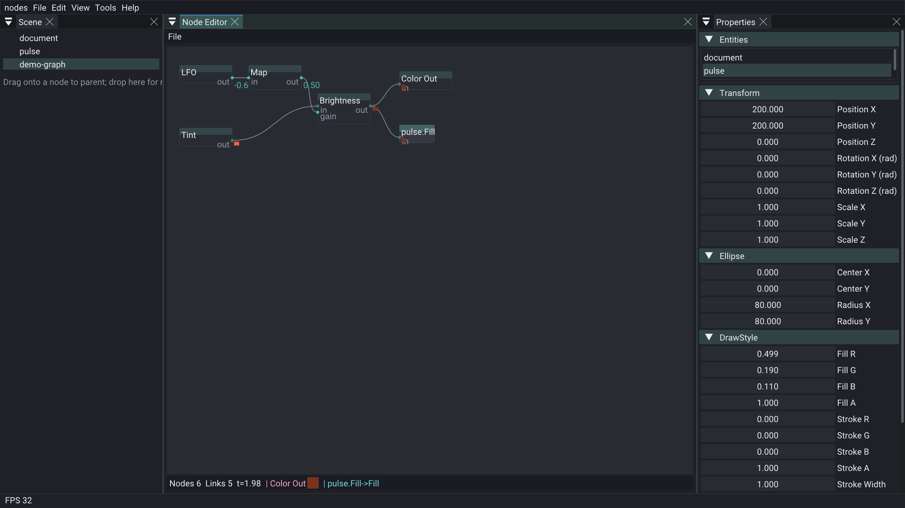

# rigNodeEditor



ImGui node graph editor over **rigNodeComponent** `CNodeGraph`.

Complete built-in catalog: Values, Maths, Modulators, Logic, Vectors, Color, Output - search in **Add node**, typed pins (green/blue/pink), color picker, live eval, Open/Save `.rig`. **Ctrl-P** opens a Patch bay (From / Destination rows) over the same graph.

Hero seeds a color-wash graph (LFO to Map to Brightness) that tints a scene circle via Color Ref.

**Artist guide:** [docs/nodes.md](https://github.com/rigkid/RigKit/blob/main/docs/nodes.md) (cheatsheet, catalog, recipes).

## Style

Format first-party `src/` and `examples/` with clang-format before commit (never `third_party/`).

```bash
./tools/format.sh
./tools/install-hooks.sh    # once per clone - pre-commit formats staged C/C++
```

Hooks only look for `clang-format` on PATH and warn, without formatting, when it is missing. Put it on PATH:

- **Windows:** install [LLVM](https://github.com/llvm/llvm-project/releases) (enable "Add LLVM to the system PATH"), or `winget install LLVM.LLVM`, then open a new shell. Confirm: `clang-format --version`.
- **macOS:** `brew install clang-format`
- **Linux:** `sudo apt install clang-format`

From a RigKit host checkout, `./tools/install-hooks.sh` wires every pack repo. Full policy: [RigKit packs Style](https://github.com/rigkid/RigKit/blob/main/packs/README.md#style).

[API/docs](https://rigkid.github.io/rigNodeEditor/)
